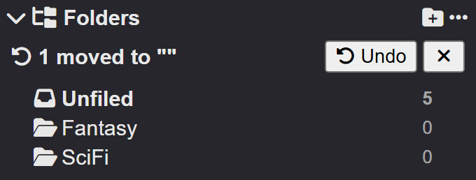
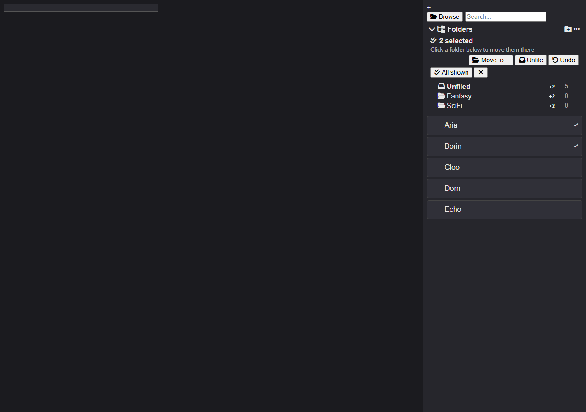

# Character Folders — Ordnersystem für das SillyTavern Character Management

Eine UI-Extension für SillyTavern (getestet mit **v1.19.0**), die dem Character Management
einen echten, verschachtelten **Ordnerbaum** gibt. Jeder Bot liegt in **genau einem** Ordner
(oder in „Unfiled"), Ordner lassen sich beliebig tief schachteln, und Charaktere wie Ordner
werden per **Drag & Drop** verschoben.

> **Wichtig:** Das sind *virtuelle* Ordner. Es wird **keine** Datei auf der Platte verschoben
> oder umbenannt — die Zuordnung lebt in deiner `settings.json`
> (`extension_settings.character_folders`). Dadurch bleiben Avatare, Chats, Gruppen,
> World-Info-Verknüpfungen und Assets unangetastet und die Extension übersteht
> SillyTavern-Updates, weil keine Core-Datei verändert wird.

> **Nie eine Core-Datei gepatcht:** Die Extension hängt sich in die vorhandene
> Filterkette (`entitiesFilter.filterFunctions`) und fügt ihr Panel in
> `#rm_characters_block` ein. Alles läuft in `data/<handle>/extensions/character-folders/`
> und ist mit Löschen des Ordners restlos entfernt.

| Ordnerpanel | Auswahl & Verschieben |
|---|---|
|  |  |

## Persistenz

* Jede **inhaltliche** Änderung (Verschieben, Ordner anlegen/umbenennen/löschen/färben,
  Import, Aufräumen, Zurücksetzen) wird **sofort** in die `settings.json` geschrieben — nicht
  nur entprellt. Ein direktes Neuladen kann also nichts verlieren.
* Reine Anzeige-Optionen (Panel eingeklappt, Options-Schalter) nutzen den entprellten Weg,
  damit nicht jeder Klick 1 MB Settings schreibt.
* `ui.openFolderId` merkt sich, welcher Ordner offen war.
* **Nicht** automatisch aufgeräumt: Zuordnungen zu Charakteren, die es nicht mehr gibt, bleiben
  erhalten (Löschen/Umbenennen wird über die ST-Events präzise nachgeführt). Die Anzahl steht
  im Options-Menü bei **Clean up assignments (N)** und wird nur auf Klick entfernt. Grund: ST
  initialisiert Extensions **vor** der Charakterliste (`script.js:747` vs. `script.js:759`) —
  eine leere Liste darf nie als „alle Charaktere gelöscht" interpretiert werden.
* **Mehrere Tabs:** ST kennt keine Konfliktbehandlung für Einstellungen. Wenn du ST in zwei Tabs
  offen hast, gewinnt der zuletzt speichernde Tab. Sortiere Bots in einem Tab.
* **Backup:** Panel → `…` → **Export structure** schreibt die komplette Struktur als JSON.
  Import ersetzt sie (mit Rückfrage).

---

## Funktionen

| Funktion | Bedienung |
|---|---|
| **Bot(s) einsortieren (empfohlen)** | Kästchen auf der Karte anklicken (mehrere sammeln, **Shift-Klick** = Bereich), dann den **Zielordner im Baum anklicken** → fertig. Oder in der Auswahlleiste **Move to…** und im Dialog den Ordner wählen. |
| Schnell alles einsortieren | Auswahlleiste → **All shown** (alle gerade sichtbaren markieren) → Zielordner anklicken |
| Verschieben rückgängig | Nach jedem Verschieben erscheint in der Auswahlleiste **Undo** (bleibt stehen, bis du sie wegklickst) |
| Aus Ordner entfernen | Markieren → Zeile **Unfiled** anklicken |
| Auswahl aufheben | **Esc** oder das **✕** in der Auswahlleiste |
| Ziehen (alternativ) | Kästchen mit gedrückter Maustaste auf einen Ordner ziehen; sind mehrere markiert, wandert die ganze Auswahl. Die Liste scrollt beim Ziehen automatisch mit. |
| Ordner anlegen | `+`-Icon im Panel-Kopf (legt im gerade geöffneten Ordner an) |
| Unterordner | Rechtsklick auf Ordner → **New subfolder** |
| Umbenennen | Doppelklick auf den Ordnernamen **oder** Rechtsklick → **Rename** |
| Farbe | Rechtsklick → **Color** (Farbe nur für Ordner-Icon, wird nicht auf Karten angewandt) |
| Sortieren | Rechtsklick → **Move up / Move down / Move to root**, oder Ordner per Drag & Drop ziehen |
| Ordner öffnen (Drilldown) | Klick auf den Ordner → Charakterliste zeigt nur dessen Inhalt, Breadcrumb oben. Solange etwas markiert ist, verschiebt der Klick stattdessen – Auswahl aufheben (Esc) stellt das Öffnen wieder her. |
| Ordner ein-/ausklappen | Chevron links im Eintrag |
| Suche/Filter | Die normale ST-Suche und die Tag-Filter arbeiten **innerhalb** des geöffneten Ordners weiter |
| Backup | Panel → `…` → **Export structure** / **Import structure** (JSON) |
| Migration | Panel → `…` → **Create folders from tags** (aus vorhandenen ST-Tags Ordner bauen) |
| Aufräumen | Panel → `…` → **Clean up assignments** (Zuordnungen gelöschter Charaktere entfernen) |

### Optionen (Panel → `…`)

* **Include subfolders when a folder is opened** — ein geöffneter Ordner zeigt auch den Inhalt
  aller Unterordner (Standard: an). Aus = nur der direkte Inhalt.
* **Show all characters at the root level** — oben („Unfiled"-Ebene) alle Charaktere zeigen statt
  nur der nicht einsortierten (Standard: aus).
* **Hide "Tags as Folders" tiles** — blendet die eingebauten Tag-Ordner-Kacheln aus, wenn du
  stattdessen dieses Ordnersystem benutzt.
* **Clicking a folder moves the current selection** — an = Klick auf einen Ordner verschiebt die
  markierten Charaktere (Standard). Aus = Klick öffnet den Ordner wie gewohnt; verschoben wird
  dann nur über **Move to…** oder Ziehen.
* **Remove all folders** — löscht nur Ordner und Zuordnungen, nie Charaktere/Chats/Tags.

---

## Installation (HomeServer)

1. Ordner `character-folders` in das Benutzerverzeichnis deiner Installation kopieren:

   ```
   <SillyTavern>/data/<handle>/extensions/character-folders/
   ```

   `<handle>` ist normalerweise `default-user` (bzw. dein Benutzername, wenn du Benutzerkonten
   aktiviert hast). Der Ordner muss `manifest.json` enthalten — sonst wird er ignoriert.

   Alternativ (für **alle** Benutzer, nur als Admin) nach
   `<SillyTavern>/public/scripts/extensions/third-party/character-folders/`.

   Hilfsskript aus diesem Workspace:

   ```powershell
   powershell -File .\install-character-folders.ps1 -SillyTavernPath 'D:\SillyTavern'
   ```

2. SillyTavern neu starten (oder die Seite hart neu laden — `Strg+F5`).

3. Im Character Management links erscheint über der Charakterliste das Panel **Folders**.
   Unter *Extensions* kann die Extension wie jede andere deaktiviert werden.

Keine Abhängigkeiten, kein Build, kein `npm install` nötig. Es werden ausschließlich
SillyTavern-Module benutzt, die ohnehin geladen sind (jQuery, jQuery UI, `script.js`).

---

## Technische Integration (für den Fall, dass du es patchen/anpassen willst)

* **Panel-Injektion:** ein `<div id="cf_panel">` wird innerhalb von `#rm_characters_block`
  direkt hinter `#charListFixedTop` eingefügt.
* **Listenfilter:** die Extension hängt **eine** zusätzliche Prädikat-Funktion in
  `entitiesFilter.filterFunctions` (siehe `public/scripts/filters.js`, `applyFilters()` reduziert
  über `Object.values(filterFunctions)`). Damit filtert die Kern-Liste nach Ordner, ohne dass
  `public/script.js` verändert wird. Sollte ST diese interne Struktur je ändern, protokolliert
  die Extension eine Warnung und der Baum funktioniert weiter — nur die Listengfilterung entfällt.
* **Drag & Drop:** jQuery UI `draggable`/`droppable` (in ST bereits enthalten, inkl.
  Touch-Punch für Mobil). Der Drag-Payload liegt in HTML-Attributen (`data-cf-kind`,
  `data-cf-avatar`, `data-folder-id`), weil jQuery UI bei eigenem Helper den **geklonten**
  Helper an `accept`/`drop` übergibt und Klone keine jQuery-`data` tragen.
* **Karten-Grip:** bei jedem `CHARACTER_PAGE_LOADED` (Ende des Listen-Renderings,
  `script.js:1067`) bekommt jede sichtbare `.character_select`-Karte das Auswahlkästchen, das
  gleichzeitig Drag-Handle ist (jQuery UI `draggable` mit `scroll: true`, damit die Liste beim
  Ziehen zum Rand automatisch scrollt — bei vielen Charakteren liegt das Ordnerpanel außerhalb
  des sichtbaren Bereichs).
* **Konsistenz:** `CHARACTER_RENAMED`, `CHARACTER_DUPLICATED` und `CHARACTER_DELETED` werden
  abonniert, damit Zuordnungen beim Umbenennen/Duplizieren/Löschen mitwandern.
* **Reine Logik:** alle Ordnerregeln (Baum, Zyklen-Schutz, Löschen ohne Datenverlust,
  Ein-Ordner-pro-Charakter-Garantie, Import/Export) liegen in `folder-store.js` — ohne DOM- oder
  ST-Abhängigkeit und damit isoliert testbar.

### Repository-Aufbau

```
.
├── character-folders/          # die Extension selbst (kopierbar nach data/<handle>/extensions/)
│   ├── manifest.json           # Manifest (Hooks: activate -> init)
│   ├── index.js                # UI + SillyTavern-Integration
│   ├── style.css               # Styling über ST-Theme-Variablen
│   ├── folder-store.js         # reine Datenlogik (kein DOM, kein ST)
│   └── folder-store.test.js    # 25 Unit-Tests (node --test)
├── verification/               # Browser-Harness: 60 Checks in echtem Chromium
│   ├── cdp.mjs                 # DevTools-Protokoll-Treiber (nur Node-Bordmittel)
│   ├── checks.mjs              # die Checks + Screenshots
│   ├── server.mjs              # Mini-Statikserver (Extension + echte ST-Assets + Stubs)
│   ├── harness.html            # nachgebautes Character-Management-Panel
│   ├── stubs/                  # Test-Doubles für script.js, utils.js, i18n.js
│   └── README.md               # wie die Verifikation aufgebaut ist
├── tools/                      # Read-only-Serverwerkzeuge (Audit/Performance)
│   ├── audit-server.sh         # System-/Installations-Audit
│   ├── deepdive*-server.sh     # Detailanalysen (Extensions, Tags, Char-Panel)
│   └── perf-check*-server.sh   # Performance-Messung (CPU, RAM, Datenlast, Seite)
├── install-character-folders.ps1
└── README.md
```

---

## Tests

```powershell
# 25 Unit-Tests der reinen Logik (keine Abhängigkeiten)
cd character-folders
node --test

# 60 Browser-Checks: echte Extension in Chromium, echtes jQuery/jQuery UI und Font Awesome
# aus einem SillyTavern-Checkout, ST-Kernmodule gestubbt. Rendering, Drilldown, Auswahl,
# Bulk-Move + Undo, Drag & Drop, Grid-Ansicht, Persistenz-Regression, Screenshots.
node verification/checks.mjs
```

Der Browser-Test braucht **kein** `npm install`: er steuert ein bereits installiertes
Chromium/Chrome/Edge direkt über das DevTools-Protokoll (`verification/cdp.mjs`, nur
Node-Bordmittel). Mit `CHROME_PATH` lässt sich ein Browser vorgeben.

Für die echten Bibliotheken sucht der Harness selbstständig einen SillyTavern-Checkout
(`ST_ROOT`, daneben/darüber liegende Ordner). Wenn keiner da ist:

```powershell
$env:ST_ROOT = 'D:\SillyTavern'; node verification/checks.mjs
```

Screenshots landen in `verification/screenshots/`.

## Server-Werkzeuge

`tools/` enthält reine Lese-Skripte, die per SSH gegen eine laufende Installation geschickt
werden (nichts wird geschrieben, kein `sudo`, keine Secrets im Output):

```bash
ST_PATH=/path/to/SillyTavern bash audit-server.sh      # System, Service, Datenlayout, Extensions
ST_PATH=/path/to/SillyTavern bash perf-check-server.sh # CPU/RAM/Platte, Config-Performance-Keys
```

`ST_PATH` überschreibt den angenommenen Pfad (`$HOME/SillyTavern`).

---

## Bekannte Grenzen

* Ordner sind virtuell — im Dateisystem (`data/<handle>/characters/`) bleibt alles flach.
  Das ist Absicht: der Avatar-Dateiname ist in ST die Charakter-ID (Chats, Gruppen, Assets
  hängen daran), echte Unterordner würden zig Kern- und Extension-Pfade brechen.
* Gruppen-Chats werden nicht einsortiert (nur Charaktere). Gruppen bleiben in der Liste sichtbar.
* Ein Charakter liegt in genau einem Ordner. Für Querschnittsthemen nutzt du weiterhin die
  normalen ST-Tags parallel.
* Die Reihenfolge innerhalb eines Ordners stellst du über **Move up/down** ein; freies
  Sortieren per Drag innerhalb derselben Ebene ist bewusst nicht enthalten (bewegt wird *in*
  Ordner).

---

## Status

**0.5.0** — im Alltag funktionsfähig und durch 25 Unit-Tests plus 60 Browser-Checks
abgesichert, aber bewusst noch vor 1.0. Vollständige Historie, behobene Fehler und die
geplanten Erweiterungen stehen in [CHANGELOG.md](CHANGELOG.md).
